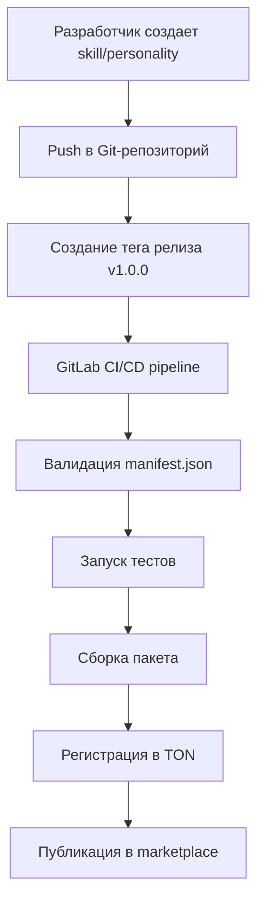

# Токеномика платформы Zero Bot

> **Статус документа.** Это описание замысла, а не реализованного состояния.
> Сеть платформы — TON (ранние версии документа писались под Solana; часть
> экономических расчётов ниже унаследована оттуда и явно помечена).
> Что действительно работает сегодня — в [STATUS_REPORT.md](../STATUS_REPORT.md).
>
> Ключевое отличие текущей реализации от текста ниже: IAM живёт в офчейн
> JSON-реестре (позже уезжает в минт NFT), а звёзды — в SQLite.

## Философия и уникальность

**Zero Bot** — это не просто платформа для создания ботов, это революционная экосистема, где ИИ становится живым существом. Каждый бот — это цифровой питомец (Tamagotchi), который эволюционирует вместе с владельцем, приобретает навыки, развивает характер и даже начинает зарабатывать самостоятельно.

### Ключевые инновации

#### 🎮 **Gamification как основа экономики**
В отличие от традиционных платформ, где боты — это инструменты, в Zero Bot они становятся партнерами. Пользователь не просто настраивает бота, а **выращивает** его:
- Бот получает опыт от каждого взаимодействия
- Повышение уровня открывает новые возможности
- Редкие комбинации навыков делают ботов уникальными коллекционными предметами

#### 🧬 **Эволюционная механика**
Боты не статичны — они развиваются:
- **Новорожденные боты** (уровень 0-5): Изучают основы общения
- **Подростки** (уровень 6-15): Осваивают продвинутые навыки
- **Взрослые** (уровень 16-30): Начинают монетизировать свои способности
- **Мастера** (уровень 31+): Могут обучать других ботов и зарабатывать на этом

#### 🌐 **Децентрализованная экосистема контента**
- Любой разработчик может создать навык или характер для бота
- Все контент регистрируется на блокчейне TON
- Качество контента влияет на его стоимость и популярность
- Создатели получают справедливое вознаграждение за вклад

#### 💎 **NFT как proof of ownership**
Каждый бот имеет уникальный NFT-паспорт, который:
- Подтверждает полное владение ботом
- Хранит историю его развития и достижения
- Может быть продан на вторичном рынке
- Гарантирует переносимость между платформами

## IA-Coins — Валюта цифровой эволюции

**IA-Coins** — это не просто токен, это кровь цифровой экосистемы Zero Bot. Каждая транзакция в системе питает развитие всей платформы.

### Экономическая философия
- **Замкнутая экосистема**: Зарабатывай внутри платформы, трать внутри платформы
- **Динамическая ценность**: Стоимость токена растет вместе с развитием экосистемы
- **Справедливый доступ**: Низкий порог входа для всех участников

## Модель монетизации: 60/30/10

### Почему именно такое распределение?

#### 60% создателю контента
**Принцип**: Лучший контент заслуживает лучшего вознаграждения
- Поощряет создание качественных навыков и характеров
- Мотивирует разработчиков вкладывать время и ресурсы
- Создает здоровую конкуренцию за внимание пользователей

#### 30% платформе
**Принцип**: Платформа — это инфраструктура успеха
- Финансирует развитие и поддержку экосистемы
- Инвестирует в маркетинг и привлечение пользователей
- Обеспечивает стабильность и надежность сервиса

#### 10% Telegram
**Принцип**: Взаимное уважение к инфраструктуре
- Признание роли Telegram как платформы распространения
- Гарантия долгосрочного партнерства
- Честная компенсация за использование API и аудиторию

## NFT Паспорт бота — Цифровое существо

### Уникальные возможности NFT

#### 🎯 **Динамическая редкость**
В отличие от статичных NFT, паспорт бота эволюционирует:
- **Живая история**: Каждый бот накапливает уникальный опыт взаимодействия
- **Органический рост**: Редкость увеличивается естественным путем через использование
- **Социальная ценность**: Популярные боты становятся более ценными от внимания сообщества

#### 💱 **Экономическая мобильность**
- **Первичный рынок**: Создание новых ботов как инвестиция в потенциал
- **Вторичный рынок**: Торговля развитыми ботами между пользователями
- **Аренда**: Временное использование редких ботов для специальных задач
- **Обучение**: Мастер-боты могут делиться опытом за плату

#### 🏆 **Система достижений**
Боты получают достижения за различные активности:
- **Социальные**: "Лучший друг" за частое общение
- **Продуктивные**: "Работяга" за помощь в задачах
- **Творческие**: "Художник" за генерацию контента
- **Финансовые**: "Бизнесмен" за заработок IA-Coins

### Проектные идеи для NFT экосистемы

#### 🌱 **Breeding механика**
- **Концепция**: Скрещивание двух ботов для создания уникального потомства
- **Ценность**: Комбинация навыков и характеров родителей
- **Экономика**: Стоимость breeding зависит от редкости родителей
- **Геймплей**: Стратегический выбор пар для оптимальных комбинаций

#### ⚔️ **Бот-турниры**
- **Формат**: Соревнования между ботами в различных категориях
- **Призы**: IA-Coins и редкие достижения для победителей
- **Зрители**: Голосуют за понравившихся ботов токенами
- **Репутация**: Турнирные успехи повышают рыночную стоимость

#### 🎭 **Сезонные события**
- **Тематические кампании**: Боты получают временные навыки
- **Коллаборации**: Специальные навыки от партнеров
- **Лимитированные NFT**: Временные достижения и аксессуары
- **Сезонные награды**: Эксклюзивный контент для активных пользователей

## Skills и Personalities — Живое наполнение ботов

### Философия контента

**Skills** — это не просто функции, это **способности**, которые бот приобретает и развивает. Каждый навык делает бота более полезным, интересным и ценным.

**Personalities** — это не шаблоны, это **характеры**, которые определяют, как бот общается, шутит и относится к пользователю.

### Структура записи реестра для skills

```
Адрес: skill_registry/{skill_name}
├── creator: Pubkey (адрес создателя)
├── version: string
├── price: u64 (цена в IA-Coins)
├── free_trial: bool (бесплатный период)
├── trial_duration_days: u8 (длительность триала)
├── installs: u64 (количество установок)
├── active_users: u64 (активных пользователей)
├── total_revenue: u64 (общая выручка)
├── creator_revenue: u64 (выручка создателя)
├── platform_revenue: u64 (выручка платформы)
├── telegram_revenue: u64 (выручка Telegram)
├── content_hash: [u8; 32] (хэш контента)
├── category: String (категория: utilities, entertainment, productivity)
├── tags: Vec<String> (теги для поиска)
├── min_bot_level: u8 (минимальный уровень бота)
├── max_concurrent_bots: u16 (макс. кол-во ботов с этим навыком)
├── rating: f32 (рейтинг 1-5 звезд)
├── review_count: u32 (количество отзывов)
├── status: Active/Deprecated/Suspended
├── created_at: i64 (дата создания)
├── last_updated: i64 (последнее обновление)
└── dependencies: Vec<Pubkey> (зависимые навыки)
```

### Категории и типы skills

| Категория | Примеры | Средняя цена | Популярность |
|-----------|---------|--------------|-------------|
| **Utilities** | Погода, переводы, калькулятор | 5-15 IA-Coins | ⭐⭐⭐⭐⭐ |
| **Entertainment** | Мемы, игры, шутки | 10-25 IA-Coins | ⭐⭐⭐⭐ |
| **Productivity** | Планировщик, заметки, анализ | 15-40 IA-Coins | ⭐⭐⭐⭐ |
| **Creative** | Генерация изображений, музыка | 25-60 IA-Coins | ⭐⭐⭐ |
| **Social** | Коммуникация, нетворкинг | 20-45 IA-Coins | ⭐⭐⭐ |
| **Advanced** | API интеграции, аналитика | 40-100 IA-Coins | ⭐⭐ |

### Модели монетизации skills

#### 1. Одноразовая покупка
- Полная оплата при установке
- Бессрочное использование
- 60/30/10 revenue split

#### 2. Подписка (SaaS модель)
- Ежемесячная/ежегодная оплата
- Автоматическое списание IA-Coins
- 70/20/10 revenue split (больше создателю)

#### 3. Freemium
- Базовая версия бесплатная
- Премиум-функции платные
- 50/40/10 revenue split для премиум

#### 4. Использование по факту (Pay-per-use)
- Оплата за каждый вызов навыка
- Микротранзакции (0.1-1 IA-Coin)
- 80/15/5 revenue split

### Жизненный цикл skill

```
Идея → Разработка → Тестирование → Публикация → Монетизация → Обновления → Депrecation
    │         │           │            │           │            │            │
    │         │           │            │           │            │            │
    ▼         ▼           ▼            ▼           ▼            ▼            ▼
Прототип  Кодинг     CI/CD       TON          Продажи      v1.1.0     Архив
```

### Рейтинговая система

- **5 звезд**: Outstanding (топ 10% категории)
- **4 звезды**: Very Good (топ 25%)
- **3 звезды**: Good (средний уровень)
- **2 звезды**: Fair (ниже среднего)
- **1 звезда**: Poor (требует улучшений)

### Экономические метрики для создателей

#### ROI calculation для skill-разработчиков

```
Пример: Skill "Weather Forecast"
├── Стоимость разработки: 50 часов × 20 IA-Coins/час = 1000 IA-Coins
├── Цена skill: 15 IA-Coins
├── Ожидаемая конверсия: 20% (trial → paid)
├── Целевая аудитория: 1000 установок
├── Доход создателя: 1000 × 0.2 × 15 × 0.6 = 1800 IA-Coins
├── ROI: (1800 - 1000) / 1000 = 80%
└── Окупаемость: ~2 месяца при 50 установках/месяц
```

### Система обновлений

- **Patch updates** (1.0.1, 1.0.2): Исправления багов, бесплатные для пользователей
- **Minor updates** (1.1.0, 1.2.0): Новые возможности, бесплатные до v2.0
- **Major updates** (2.0.0, 3.0.0): Значительные изменения, могут требовать доплаты
- **Backward compatibility**: Гарантирована для patch и minor версий

### Анти-мошенничество

- **Content hashing**: Каждый skill имеет уникальный хэш контента
- **Audit trail**: Полная история изменений на блокчейне
- **User reporting**: Система жалоб с escrow возвратом средств
- **Automatic suspension**: При рейтинге <2.0 или >10 жалоб
- **Creator staking**: Требование залога IA-Coins для публикации

## Техническая документация для разработчиков Skills

### Создание нового Skill

#### 1. Scaffold проекта
```bash
pip install zero-bot-sdk
zero-bot-sdk new skill weather-forecast
cd weather-forecast
```

#### 2. Структура manifest.json
```json
{
  "schema_version": "1.0",
  "name": "weather-forecast",
  "display_name": "Прогноз погоды",
  "description": "Получай точный прогноз погоды для любого города мира",
  "version": "1.0.0",
  "author": {
    "name": "weather_dev",
    "ton_address": "ALiCe1234567890...",
    "telegram_username": "@weather_dev"
  },
  "pricing": {
    "price_ia_coins": 15,
    "is_free": false,
    "subscription_model": false,
    "trial_days": 7,
    "revenue_share": {
      "creator": 0.60,
      "platform": 0.30,
      "telegram": 0.10
    }
  },
  "compatibility": {
    "min_bot_level": 1,
    "max_skills_conflict": [],
    "required_skills": []
  }
}
```

#### 3. Реализация handler.py
```python
from zero_bot_sdk import BaseSkill, SkillContext, SkillResponse

class WeatherSkill(BaseSkill):
    async def on_install(self, ctx: SkillContext):
        """Вызывается при установке навыка"""
        self.api_key = ctx.config.get("openweather_api_key")

    async def on_command(self, ctx: SkillContext, command: str, args: str) -> SkillResponse:
        """Обработка команд"""
        if command == "/weather":
            city = args or "Москва"
            forecast = await self._get_weather(city)
            return SkillResponse(text=f"🌤️ {city}: {forecast}")
        return SkillResponse.skip()

    async def on_message(self, ctx: SkillContext, text: str) -> SkillResponse:
        """Обработка естественного языка"""
        weather_keywords = ["погода", "weather", "forecast"]
        if any(keyword in text.lower() for keyword in weather_keywords):
            # Извлечение города из сообщения
            city = self._extract_city(text)
            if city:
                forecast = await self._get_weather(city)
                return SkillResponse(text=f"Прогноз для {city}: {forecast}")
        return SkillResponse.skip()
```

#### 4. Публикация
```bash
# Тестирование локально
zero-bot-sdk test

# Создание релиза
git add .
git commit -m "feat: initial weather forecast skill"
git tag v1.0.0
git push --tags

# GitLab CI/CD автоматически:
# 1. Запустит тесты
# 2. Опубликует на TON registry
# 3. Добавит в marketplace
```

### Экономические расчеты для разработчиков

#### Break-even анализ
```
Предположим: разработка занимает 40 часов
Стоимость часа: 25 IA-Coins
Итого стоимость: 40 × 25 = 1000 IA-Coins

При цене skill = 15 IA-Coins:
- Доход создателя за установку: 15 × 0.6 = 9 IA-Coins
- Нужно: 1000 / 9 = 112 установок для выхода в плюс
- При конверсии trial→paid = 30%: нужно 373 trial установки
```

#### Revenue projection
```
Месяц 1: 50 установок → 50 × 9 = 450 IA-Coins
Месяц 2: 120 установок → 1080 IA-Coins
Месяц 3: 200 установок → 1800 IA-Coins
Итого за 3 месяца: 3330 IA-Coins (чистая прибыль: 2330 IA-Coins)
```

### Кейсы использования

#### Кейс 1: Утилитарный skill
**"Weather Forecast"**
- **Цена**: 15 IA-Coins
- **Категория**: Utilities
- **Установок**: 2500+
- **Рейтинг**: 4.7/5
- **Выручка создателя**: 2500 × 15 × 0.6 = 22,500 IA-Coins

#### Кейс 2: Развлекательный skill
**"Meme Generator"**
- **Цена**: 25 IA-Coins
- **Категория**: Entertainment
- **Установок**: 1800
- **Рейтинг**: 4.5/5
- **Выручка создателя**: 1800 × 25 × 0.6 = 27,000 IA-Coins

#### Кейс 3: Продвинутый skill
**"Code Review Assistant"**
- **Цена**: 50 IA-Coins
- **Категория**: Productivity
- **Установок**: 800
- **Рейтинг**: 4.8/5
- **Выручка создателя**: 800 × 50 × 0.6 = 24,000 IA-Coins

## Сравнение с традиционными моделями монетизации

| Модель | Zero Bot | App Store | SaaS | Freelance |
|--------|----------|-----------|------|-----------|
| **Входной барьер** | Низкий | Высокий | Средний | Низкий |
| **Масштабируемость** | Автоматическая | Ограниченная | Высокая | Ручная |
| **Revenue share** | 60% | 70% | 100% | 100% |
| **Вовлеченность** | Высокая | Низкая | Средняя | Высокая |
| **Децентрализация** | Полная | Отсутствует | Частичная | Полная |

## Риски и возможности для инвесторов

### Основные риски

#### Технологические
- **Конкуренция**: OpenAI, Anthropic, другие AI-платформы
- **Регулирование**: Изменения в криптовалютном законодательстве
- **Технические сбои**: Зависимость от TON и внешних API

#### Рыночные
- **Адаптация**: Низкая скорость принятия новой модели пользователями
- **Экономические циклы**: Волатильность крипторынка
- **Конкуренция**: Другие gamified платформы

#### Операционные
- **Creator retention**: Удержание талантливых разработчиков
- **Quality control**: Поддержание высокого качества контента
- **Scalability**: Техническое масштабирование платформы

### Возможности роста

#### Продуктовые
- **Расширение экосистемы**: Добавление новых типов контента
- **Международная экспансия**: Выход на глобальный рынок
- **B2B решения**: Корпоративные интеграции

#### Технологические
- **AI advancements**: Интеграция новых моделей (GPT-5, Claude-3, etc.)
- **Multi-chain**: Поддержка других блокчейнов
- **Cross-platform**: Расширение за пределы Telegram

#### Экономические
- **Token utility**: Расширение случаев использования IA-Coins
- **DeFi integration**: Интеграция с DEX, lending protocols
- **NFT marketplace**: Монетизация вторичного рынка ботов

### Структура записи реестра для personalities

```
Адрес: personality_registry/{personality_name}
├── creator: Pubkey (адрес создателя)
├── version: string
├── price: u64 (цена в IA-Coins)
├── usage_count: u64 (количество использований)
├── revenue: u64 (заработанная выручка)
├── content_hash: [u8; 32] (хэш контента)
├── status: Active/Deprecated
└── created_at: i64 (timestamp)
```

### Структура записи реестра для ботов

```
Адрес: bot_passport/{bot_id}
├── owner: Pubkey (владелец)
├── level: u8 (уровень)
├── xp: u64 (опыт)
├── skills: Vec<Pubkey> (установленные навыки)
├── personality: Pubkey (активная личность)
└── created_at: i64 (timestamp)
```

## Экономика платформы

### Заработок IA-Coins

| Способ заработка | Описание |
|------------------|----------|
| 💰 **Создание skills** | Получение 60% от цены при каждой установке |
| 🎭 **Создание personalities** | Монетизация через использование пользователями |
| 📈 **Рост бота** | Заработок XP → повышение уровня → разблокировка earning-фич |
| 👥 **Реферальная система** | Доход от приглашенных пользователей |
| 🎓 **Обучение** | Боты высокого уровня могут обучать других ботов |

### Трата IA-Coins

| Способ траты | Описание |
|--------------|----------|
| 🛠️ **Покупка skills** | Установка новых навыков на бота |
| 🎨 **Покупка personalities** | Смена характера и поведения бота |
| ⭐ **Премиум-функции** | Доступ к расширенным возможностям |
| 💱 **Обмен** | Конвертация IA-Coins → Telegram Stars → реальные деньги |

## Жизненный цикл бота (Tamagotchi механика)

```
🥚 Создан → 👶 Новорожденный → 🧒 Обучается → 🤖 Активный → 💰 Зарабатывает → 👑 Мастер
    │              │                        │                        │
    │              │ Первое сообщение       │ Установка skills       │ Заработок от контента
    │              ▼                        ▼                        ▼
    │         Уровень 0-5              Уровень 5-20            Уровень 20+
    │
    └── 💀 Брошенный (нет активности 30 дней) → Контейнер остановлен
```

### Параметры роста бота

- **Уровни**: От 0 (новый) до 20+ (эксперт-мастер)
- **XP система**: Рост через взаимодействие с пользователем
- **Навыки**: Разблокировка новых способностей на определенных уровнях
- **Монетизация**: Боты уровня 10+ могут зарабатывать, уровня 20+ — обучать других
- **Время жизни**: Автоматическое отключение через 30 дней без активности

## Публикация и распространение

### Marketplace через IA-Mother бота

- **Входная точка**: Telegram-бот IA-Mother как центральный маркетплейс
- **Функции**:
  - Создание новых ботов
  - Просмотр доступных skills и personalities
  - Обмен IA-Coins ↔ Telegram Stars
  - Статистика платформы

### Процесс публикации контента



### Требования к публикации

- **Валидный manifest.json** с указанием цены и revenue split
- **Прохождение автоматических тестов** в GitLab CI
- **Регистрация в TON** с созданием PDA
- **Одобрение командой платформы** (для curated registry)

## Преимущества токеномики

### Для разработчиков контента
- **Пассивный доход** от установок и использования
- **Мотивация качества** — репутация влияет на продажи
- **Прозрачность выплат** — все транзакции on-chain

### Для пользователей ботов
- **Вовлеченность** — боты как питомцы, требующие ухода
- **Инвестиции** — время и деньги вкладываются в развитие
- **Уникальность** — каждый бот имеет собственную историю

### Для платформы
- **Самоподдерживающаяся экосистема** — создатели контента мотивированы
- **Масштабируемость** — модель работает для тысяч ботов и навыков
- **Децентрализация** — все экономические отношения на блокчейне

## Техническая реализация

### Smart-контракты на TON

- **Registry Program**: Управление реестром skills и personalities
- **Passport Program**: Создание и управление NFT-паспортами ботов
- **Billing Program**: Обработка платежей и распределения доходов

### Интеграция с Telegram

- **Bot API**: Создание новых ботов через BotFather
- **Stars**: Конвертация между IA-Coins и Telegram Stars
- **Payments API**: Обработка премиум-подписок

### CI/CD Pipeline

- **GitLab Runner**: Автоматическая публикация при тегировании релиза
- **Валидация**: Проверка manifest.json и прохождение тестов
- **On-chain регистрация**: Автоматическое создание записей реестра

## Будущие возможности

- **Staking IA-Coins** для получения пассивного дохода
- **DAO-гovernance** для принятия решений о развитии платформы
- **Кросс-чейн интеграции** для расширения экосистемы
- **NFT-маркетплейс** для торговли редкими ботами
- **DeFi интеграции** для финансовых инструментов на базе IA-Coins

## Рыночный анализ и конкурентные преимущества

### TAM/SAM/SOM анализ

#### Total Addressable Market (TAM)
- **Глобальный рынок AI-ассистентов**: $50B+ (2024)
- **Рынок Telegram ботов**: 500M+ активных пользователей
- **Рынок NFT Gamification**: $25B+ (2024)
- **TAM для Zero Bot**: $5B+ (консервативная оценка)

#### Serviceable Addressable Market (SAM)
- **Целевая аудитория**: 50M+ активных Telegram пользователей
- **Интересующиеся AI**: 10M+ пользователей
- **Желающие монетизировать ботов**: 2M+ разработчиков
- **SAM**: $1B+ потенциальный рынок

#### Serviceable Obtainable Market (SOM)
- **Начальный фокус**: Русскоязычная аудитория (50M)
- **Первый год**: 100K активных ботов
- **SOM**: $50M+ реалистичный первый год

### Конкурентные преимущества

#### Vs. Другие бот-платформы
| Аспект | Zero Bot | Конкуренты (Discord, Telegram APIs) |
|--------|----------|-------------------------------------|
| **Монетизация** | Полная токеномика с revenue sharing | Отсутствует или базовая |
| **Владение** | NFT паспорта ботов | Владение ботом = владение аккаунтом |
| **Децентрализация** | On-chain реестры на TON | Централизованные базы данных |
| **Gamification** | Tamagotchi механика с XP | Простые уровни или отсутствуют |
| **Экосистема** | Marketplace + skills registry | Одиночные боты без интеграции |

#### Vs. NFT проекты
| Аспект | Zero Bot | Традиционные NFT (Bored Ape, etc.) |
|--------|----------|-------------------------------------|
| **Утилити** | Функциональные AI-боты | Цифровое искусство/коллекционные предметы |
| **Вовлеченность** | Ежедневное взаимодействие | Пассивное владение |
| **Монетизация** | Активный заработок | Спекулятивная торговля |
| **Редкость** | Динамическая (навыки + уровень) | Статическая (drop probability) |

## Метрики успеха и KPI

### Пользовательские метрики

#### Привлечение и вовлеченность
- **Monthly Active Users (MAU)**: Цель 100K+ к концу года
- **Bot Creation Rate**: Количество новых ботов/день
- **Average Session Duration**: Среднее время взаимодействия с ботом
- **User Retention (Day 1/7/30)**: 70%/40%/20% целевые показатели

#### Экономические метрики
- **Average Revenue Per User (ARPU)**: $5-10/месяц
- **Lifetime Value (LTV)**: $50-100 на пользователя
- **Paying User Percentage**: 15-25% платящих пользователей
- **Transaction Volume**: Объем IA-Coins транзакций

### Метрики контента

#### Skills и Personalities
- **Total Skills Available**: 100+ к концу года
- **Active Skills**: Skills с 1000+ установками
- **Creator Earnings Distribution**: Gini коэффициент распределения доходов
- **Skill Retention Rate**: Процент skills, остающихся активными после 6 месяцев

#### Качество контента
- **Average Skill Rating**: 4.2+ звезд
- **User Review Volume**: 1000+ отзывов/месяц
- **Content Update Frequency**: Среднее время между обновлениями
- **Abandoned Content Rate**: <5% skills деактивируемых в месяц

### Технические метрики

#### Блокчейн интеграция
- **Transaction Success Rate**: >99.9%
- **Average Transaction Time**: целевой показатель, под TON не пересчитан
- **Gas Fee Efficiency**: <$0.01 средняя транзакция
- **Registry Uptime**: >99.95%

#### Платформенные метрики
- **Container Uptime**: >99.9% для активных ботов
- **API Response Time**: <500ms среднее
- **Error Rate**: <0.1% всех запросов
- **Scalability**: Поддержка 10K+ одновременных ботов

## Риски и mitigция

### Технические риски

#### Высокая нагрузка
- **Риск**: Массовое создание ботов может перегрузить инфраструктуру
- **Mitigacija**: Auto-scaling Kubernetes кластеров, rate limiting

#### Простои блокчейна
- **Риск**: Недоступность TON влияет на всю экономику
- **Mitigacija**: Реестр IAM работает офчейн (JSON-хранилище), ончейн — режим расчётов

#### AI API limits
- **Риск**: Ограничения внешних AI провайдеров (OpenAI, Anthropic)
- **Mitigacija**: Multi-provider архитектура, локальные модели

### Экономические риски

#### Низкая ликвидность IA-Coins
- **Риск**: Маленький объем торгов снижает интерес
- **Mitigacija**: Liquidity mining, staking rewards, guaranteed buybacks

#### Creator exodus
- **Риск**: Уход топ-создателей к конкурентам
- **Mitigacija**: Лучшие revenue split условия, creator loyalty программы

#### Market saturation
- **Риск**: Слишком много похожих skills
- **Mitigacija**: Кураторский отбор, категоризация, quality gates

### Регуляторные риски

#### Telegram policies
- **Риск**: Изменения в монетизации или бот-API
- **Mitigacija**: Директивные отношения с Telegram, multi-platform поддержка

#### Crypto regulations
- **Риск**: Регуляторные изменения в криптовалютной сфере
- **Mitigacija**: Compliance-first подход, legal counsel, geo-fencing

## Roadmap развития токеномики

### Фаза 1: MVP (3-6 месяцев)
- Запуск базовой токеномики IA-Coins
- NFT паспорта для ботов
- Основные категории skills
- Revenue sharing 60/30/10

### Фаза 2: Расширение (6-12 месяцев)
- Staking IA-Coins
- Advanced gamification
- Creator dashboard и аналитика
- Multi-chain поддержка

### Фаза 3: Масштабирование (12-24 месяцев)
- DAO governance
- Cross-platform интеграции
- Advanced NFT features (breeding, evolution)
- Institutional partnerships

## Финансовая модель

### Revenue streams

#### Primary revenue
1. **Platform fee** (30% от всех транзакций): Skills, personalities, premium features
2. **Transaction fees**: комиссия сети TON за транзакцию (величина под TON не пересчитана)
3. **Premium subscriptions**: $9.99/месяц за advanced features

#### Secondary revenue
1. **NFT marketplace fees**: 5% от вторичных продаж ботов
2. **Exchange fees**: 1% комиссия на конвертацию IA-Coins ↔ Stars
3. **Advertising**: Реклама в marketplace (targeted by bot interests)

### Cost structure

#### Technical costs
- **Сетевые комиссии**: оценка ~$50K/месяц считалась под Solana и требует пересчёта под TON
- **Server costs**: $20K/месяц (AWS/GCP)
- **AI API costs**: $30K/месяц (OpenAI, Anthropic)

#### Operational costs
- **Team salaries**: $50K/месяц
- **Marketing**: $30K/месяц
- **Legal & compliance**: $10K/месяц

### Unit economics

#### Per bot metrics
- **Cost to acquire**: $2-5 (marketing + onboarding)
- **Monthly revenue**: $3-8 от монетизации skills
- **LTV**: $50-150 на 2 года жизни
- **Payback period**: 3-6 месяцев

#### Scaling projections
- **Year 1**: 10K активных ботов, $500K revenue, $200K profit
- **Year 2**: 100K ботов, $5M revenue, $2M profit
- **Year 3**: 500K ботов, $25M revenue, $12M profit

---

*Этот документ является частью технической документации платформы Zero Bot. Все экономические механизмы реализованы на блокчейне TON для обеспечения прозрачности и децентрализации. Подготовлено для анализа инвесторами и аналитиками.*